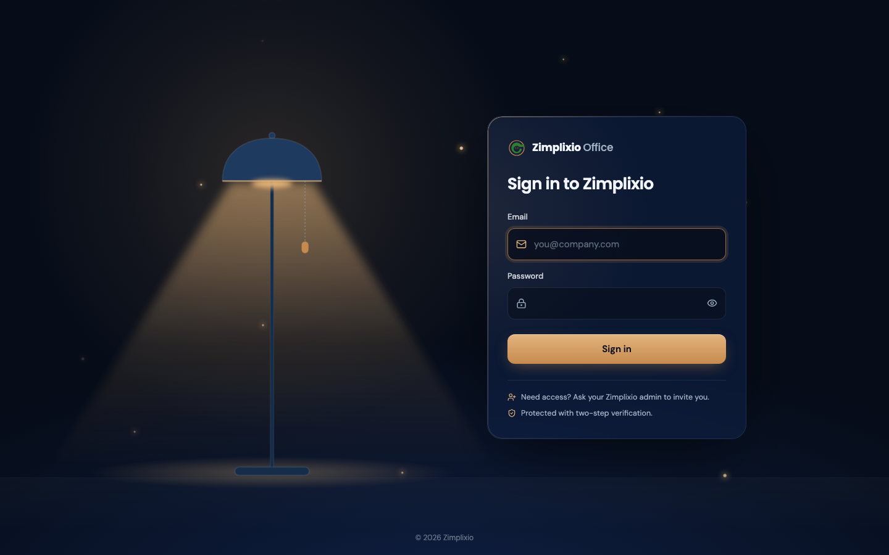
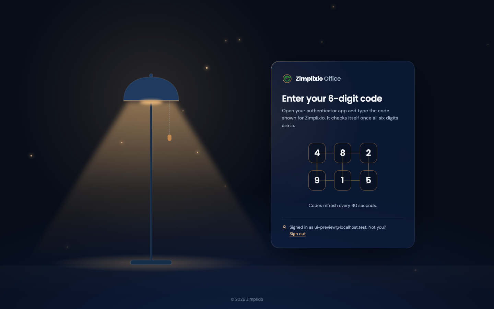
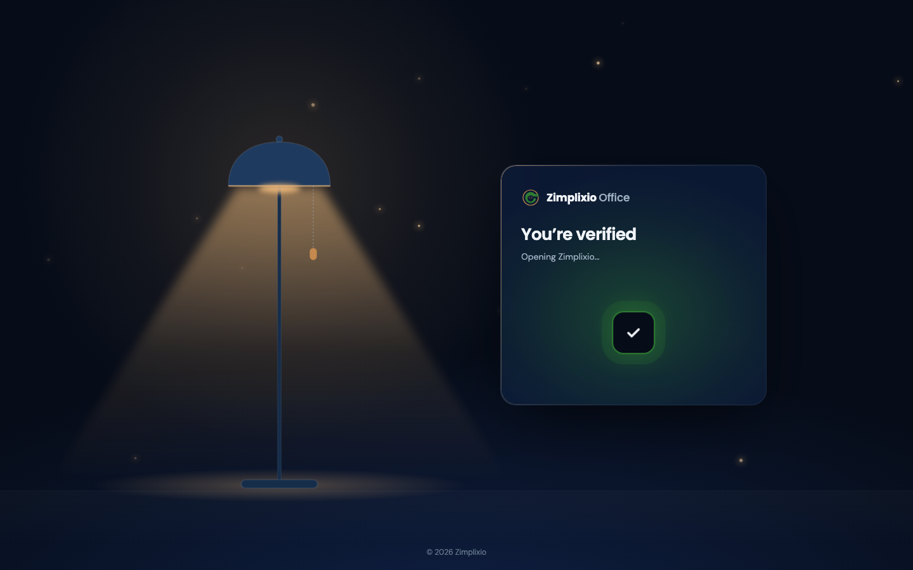
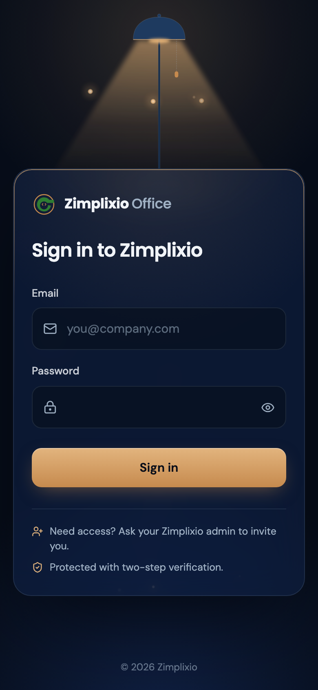

# Zimplixio Office

Zimplixio Office is the internal operating platform for Zimplixio, a consultancy serving US small and mid-sized businesses. It's built as a company organized into departments: Product/Research, Engineering, Marketing, Sales, Finance and Operations. Each department shares the same structure, and each gets its own tools as it's built out. The long-term direction is an agent-run company that the owner supervises: AI agents propose work, and a human approves anything before it goes live. The same portal will later serve Zimplixio's clients.

**Live:** [crm.zimplixio.com](https://crm.zimplixio.com)

[](https://nextjs.org)
[](https://www.typescriptlang.org)
[](https://www.prisma.io)
[](https://docs.anthropic.com)
[](https://railway.app)

---

[](docs/screenshots/login-lit.png)
**Sign in.** The room starts dark. Pull the lamp's chain, or wait 10 seconds, and the light comes on and the sign-in card appears.

[](docs/screenshots/mfa-verifying.png)
**Two-step verification.** The six code boxes form a "circuit" while the server checks the code. They collapse into a green check once it's approved.

[](docs/screenshots/mfa-verified.png)
**Verified.** The card fills with green before opening the app.

[](docs/screenshots/login-phone.png)

---

## What's here

- **Departments as the org chart.** The sidebar lists all six departments. Each one shares the same base: goals, tasks, knowledge and KPIs. Only Product/Research is fully built; the other five are visible placeholders ("reserved seats").
- **Research Engine.** A weekly background job, also available on demand, that finds candidate service opportunities. It gathers signal with Tavily web search, then reasons over it in two Claude passes.
- **Human review gate.** Every AI finding starts as a *candidate*. Only a person clicking Validate or Reject (with a written reason) changes that.
- **Learning loop.** Each round of reviews is distilled into a plain-English Guidance Summary, which is fed into the next run.
- **Research Probe (proof of concept).** Investigates one named company at a time and shows every step: each signal item gathered, and each hypothesis, kept or rejected.
- **Secure sign-in.** Email and password, plus two-step verification with an authenticator app (Twilio Verify TOTP), enforced at both the page and API layers.

## Tech Stack

| Layer | Technology |
|---|---|
| Framework | Next.js 16 (App Router): server components plus client components |
| Language | TypeScript (strict) |
| Database | PostgreSQL via Prisma 7 (driver adapter `@prisma/adapter-pg`) |
| Background jobs | pg-boss (Postgres-backed queue) on a separate Worker service |
| Auth | NextAuth v5 (credentials, JWT sessions) and Twilio Verify TOTP |
| AI | Anthropic Claude API: Sonnet for reasoning, Haiku for cheap review passes |
| Web research | Tavily (`search` and `extract`) |
| Styling | Tailwind CSS v4 with a token-based design system (navy, forest green, copper) |
| Validation | Zod v4: env vars at boot, API inputs, AI tool schemas |
| Logging | pino, with secrets redacted |
| Hosting | Railway (web service and Worker, one shared Postgres), behind Cloudflare |
| Secrets hygiene | gitleaks pre-commit hook (husky) |

---

## Engineering Notes

The decisions that shaped the codebase, and why. The things that broke along the way are in [docs/GOTCHAS.md](docs/GOTCHAS.md).

### One generic department, not six bespoke modules

The first plan was a service module per department. That would have meant six slightly different copies of the same goal, task, knowledge and KPI code. Instead there's one `Department` table (`key, name, status, order`), and shared `Goal` / `Task` / `Knowledge` / `Kpi` tables that each reference it.

Anything a single department needs gets its own small table keyed to that department. Product/Research's Company Profile, Guidance Summary and Findings are examples. **Adding a department means one new row, plus optional extension tables. Existing departments are never touched.**

The routes follow the same idea:
- One dynamic route, `departments/[key]`, serves every reserved or simple department.
- A fully built department gets a static route folder. Next.js picks the static folder first, so it shadows the generic route without touching it.

### Nothing goes live without a human

The Research Engine can only ever write `status: 'CANDIDATE'`. A Finding reaches `VALIDATED` or `REJECTED` only when a person clicks a button, and rejecting requires a written reason. That reason is what the learning loop learns from. This is a hard rule for every future department's agents: they propose, a human approves.

### Abort, don't retry

Each Research Engine stage (Ground → Gather → Hypothesize → Test → Queue) validates Claude's structured output against a Zod schema. If the output doesn't match, the run **stops** rather than retrying or patching the data. A wasted run costs a few cents. Silently storing malformed findings would poison the review queue and the learning loop that feeds off it.

The flip side is that schema limits need deliberate headroom, because Claude writes more naturally than a tight `.max()` expects. See [GOTCHAS #9](docs/GOTCHAS.md#9-leave-headroom-on-every-length-limit-in-claudes-structured-output).

### MFA that the browser can't talk its way past

NextAuth lets a logged-in browser refresh its own session token with arbitrary data. The original setup trusted that data, which meant the "MFA verified" flag could be claimed rather than earned. The fix moves all trust to the server:

| On a session refresh… | Before | Now |
|---|---|---|
| "MFA is enabled" | taken from the browser | re-read from the database |
| "MFA verified" | taken from the browser | only with a server-signed proof (HMAC), bound to the user and that login session, valid 2 minutes, issued only after Twilio approves a code |
| Re-enrolling an authenticator | allowed for a password-only session | requires an already-verified session |

Each case was reproduced live before the fix and re-run against it afterwards, along with forged, expired and cross-session proofs. All were blocked; a genuine proof still gets in.

### A sign-in screen with a point of view

The design system's motion rule for the app is "calm and fast beats spectacle". The three sign-in screens are the one deliberate exception. People see them for a few seconds, and they're the first impression for employees and future clients.

The whole scene is built from the shared design system rather than one-off styling:
- **Tokens:** colors and glows live as tokens in `globals.css` and are exposed as Tailwind classes through `@theme`.
- **One stylesheet:** every animation is in `src/styles/auth.css`. The React components only toggle `data-*` state ("lit", "verifying", "verified"). There's no inline styling and no hex color in components.
- **Honest animation:** the code-verification animation follows the real server answer. The "circuit" holds while the server checks, and the green check never appears before the server says yes.
- **Accessibility:**
  - The lamp is a real button.
  - The card can't be focused until the lamp is lit.
  - Reduced-motion users get the lit scene with no animation.
  - The code input accepts paste and the phone's one-time-code autofill.

### Accepted trade-offs

- **The Research Probe runs synchronously.** It does the whole pipeline inside one web request, which can take up to about 60 seconds. That works because Railway runs a long-lived server, not serverless functions. A proof of concept didn't justify a job queue.
- **MFA verification lasts for the session.** Once verified, a session stays verified until the token expires. There's no re-check before sensitive actions yet.
- **The Content Security Policy is in report-only mode,** with no reporting endpoint. Switching to enforcing mode needs a manual pass across the app.
- **One known dependency advisory is accepted.** `effect` is used only by the Prisma CLI to read its own config file, and it isn't loaded by the app at runtime. The suggested automatic fix would downgrade Prisma 7 to 6. We're waiting for Prisma's patch instead.

---

## Testing

An automated **Vitest** suite covers the access-control layer (account rules, session revocation, route guards, the proxy rules, `withAuth`, tenancy and the migration). It runs against a separate database whose name must end in `_test` (set `DATABASE_URL_TEST`); the suite refuses to start otherwise.

```bash
npm test                                # Vitest suite
npx tsc --noEmit                        # type check (app + worker code)
npx eslint src                          # lint
rm -rf node_modules && npm ci && npm run build   # required after any dependency change
```

Beyond the suite, changes are verified with live checks: ad-hoc Playwright and `curl` scripts run against `next dev`, using throwaway local test users that are deleted afterwards (the full sign-in and MFA flow, the MFA bypass attempts, the open-redirect check, client-portal lockout and session revocation).

## Known Gaps

- **Limited automated tests.** The access layer has a Vitest suite; the research and review features do not yet. See Testing.
- **User and company management is in progress.** Step 1 (companies, client accounts, the access wall, revocation) is built. There is still no screen to invite users or assign roles; use the interim CLI below until step 2 lands.
- **No password reset or MFA recovery codes.** There's no email-sending service yet. A lost authenticator currently needs a manual database change.
- **No audit log.** Logins, MFA events and Finding approvals are recorded only in application logs, not in a queryable table.
- **Goals and Tasks have no create screen.** The tables exist, but there's no UI or API to add rows.
- **Older dashboard pages predate the design-token system.** They still use some inline styles and need migrating to the shared classes.
- **No production Railway environment yet.** The live site runs from the `development` environment.

---

## Application Flows

### Sign-in

1. Any signed-out visit to a protected page redirects to `/login` and remembers the page (`?callbackUrl=`). The return address is checked so that only same-site paths are accepted.
2. Email and password sign-in (rate limited: 5 attempts per 15 minutes per email). If MFA is on, the middleware sends you to `/verify-mfa`, keeping the return address.
3. A correct code earns a server-signed proof, which upgrades the session. You land on the page you were originally trying to open.

If a session ended on its own (not a deliberate sign-out), `/login` says so.

### Research Engine run

| Stage | What it does |
|---|---|
| Ground | Loads the Company Profile (what Zimplixio can credibly offer) and the Guidance Summary (what past reviews taught) |
| Gather | Runs a fixed set of Tavily searches for current small-business signal |
| Hypothesize | First Claude pass: proposes candidate service opportunities |
| Test | Second Claude pass: challenges each hypothesis against the evidence and the company's fit |
| Queue | Deduplicates against existing Findings and writes survivors as `CANDIDATE` |

Runs weekly (Monday 08:00 UTC) on the Worker, or on demand with **Run now** (one run per 5 minutes; only one run can be active or queued at a time).

### Review and learning loop

Candidates appear in the Findings tab. **Validate** promotes one. **Reject** requires a written reason. After each review round, the decisions are distilled into the Guidance Summary, which the next run reads in its Ground stage.

### Research Probe

Gather (targeted searches for one named company, plus your own notes and URLs) → Deepen (re-fetches shallow search results as full pages) → Review (Claude Haiku drops same-name-different-company items and duplicates) → Hypothesize → Test.

Every kept signal item and every hypothesis is stored and shown on the run's page. Noise is kept in the database for learning but hidden from view. Rate limited to one run per 2 minutes. It uses its own tables and shares nothing with the Research Engine.

---

## Getting Started

### Prerequisites

Node.js 20 (nvm) · PostgreSQL · `gitleaks` (`brew install gitleaks`, used by the pre-commit hook) · API keys for Anthropic, Tavily and Twilio Verify

### Setup

```bash
git clone https://github.com/root-else-sudo/Zimplixio_Office.git
cd Zimplixio_Office
npm install                 # also runs `prisma generate` and installs the gitleaks hook
# create .env at the repo root with the variables listed under Environment Variables (it's gitignored)
npx prisma migrate dev      # apply all migrations
SEED_EMAIL=you@example.com SEED_PASSWORD='<strong password>' npm run seed   # admin user + six departments
npm run dev                 # http://localhost:3000
npm run worker              # optional: background jobs (Research Engine)
```

> Always set `SEED_EMAIL` and `SEED_PASSWORD` when seeding. Don't rely on the script's built-in fallbacks.

Run the dev server on the port that `NEXTAUTH_URL` names, or post-login redirects will go to the wrong port.

### Useful commands

```bash
npx prisma studio           # browse the database
npx prisma migrate dev      # after any schema change (schema.prisma is the source of truth)
npx prisma generate         # regenerate the client only
```

## Project Structure

The main folders:

```
src/
  app/
    (auth)/                login, verify-mfa, setup-mfa: server page.tsx + *Client.tsx, shared lamp scene in layout.tsx
    (dashboard)/           the signed-in app: sidebar layout, departments, settings
      departments/[key]/           generic department page (reserved seats)
      departments/product-research/ static route tree: overview, company profile, guidance, findings, workflow (Probe)
    api/                   route handlers: all mutations and job enqueues (findings, mfa, research, research-probe…)
    globals.css            design tokens (:root), Tailwind @theme mapping, shared component classes
  components/
    auth/                  AuthScene, Lamp, Fireflies, AuthCard, AuthField, CodeInput, useCodeVerification
    brand/                 ZimplixioMark (the logo)
    departments/           shared department UI (anatomy, findings rows, reserved state…)
  lib/
    auth.ts, auth.config.ts  NextAuth setup (edge-safe base config + server-side session-update checks)
    mfa-proof.ts           server-signed MFA proofs
    auth-redirect.ts       return-to-page and "session ended" rules
    rbac.ts                withAuth(): session, role and MFA checks for API routes
    research/              Research Engine stages (queries, Tavily, prompts, schemas, dedupe, engine)
    research-probe/        Research Probe stages (gather, deepen, review, prompts, schemas, engine)
    ai-client.ts, ai/      Claude wrapper, cost tracking, Zod → JSON Schema
    env.ts                 Zod-validated server env (empty during next build)
  styles/auth.css          all sign-in screen visuals and animations
  proxy.ts                 middleware: redirects to login / MFA, carries the return address
worker/src/                pg-boss worker: weekly schedule + research.run handler
prisma/                    schema.prisma, migrations, seed.ts
docs/                      ENV, RAILWAY, SECURITY, GOTCHAS, screenshots, superpowers/ (specs & plans)
```

## Environment Variables

All server variables are validated once at startup by a Zod schema (`src/lib/env.ts`). A misconfigured deploy refuses to start with a readable error. Both Railway services use the same variables. Full reference: [docs/ENV.md](docs/ENV.md).

### Core

| Variable | Dev value | Description |
|---|---|---|
| `DATABASE_URL` | `postgresql://…/zimplixio_office` | Postgres connection (Railway: `${{Postgres.DATABASE_URL}}`) |
| `NEXTAUTH_URL` | `http://localhost:3000` | Public base URL; decides where auth redirects go |
| `NEXTAUTH_SECRET` | 32+ random characters | Signs session tokens (and, domain-separated, MFA proofs) |
| `AUTH_TRUST_HOST` | not needed locally | Set to `1` in production (behind Cloudflare/Railway) |
| `NODE_ENV` | `development` | Logger format, Prisma behavior |
| `LOG_LEVEL` | `info` | `fatal` · `error` · `warn` · `info` · `debug` · `trace` |

### AI & research

| Variable | Description |
|---|---|
| `ANTHROPIC_API_KEY` | Claude: Research Engine (Worker) and Research Probe (web service) |
| `TAVILY_API_KEY` | Web search: required on **both** services, since the Probe calls it from the web service |

### Two-step verification (Twilio Verify)

| Variable | Description |
|---|---|
| `TWILIO_ACCOUNT_SID` | Twilio account |
| `TWILIO_AUTH_TOKEN` | Twilio auth token |
| `TWILIO_VERIFY_SERVICE_SID` | The Verify service that holds the TOTP factors |
| `TWILIO_SMS_FROM`, `SMS_NOTIFY_TO` | Optional; reserved for future notifications (unused) |

### Seeding only

| Variable | Description |
|---|---|
| `SEED_EMAIL`, `SEED_PASSWORD` | Admin account created by `npm run seed`. Always set both. |

> Legacy variables `PIPELINE_USE_QUEUE` and `MARKETING_DIR` are still accepted but unused, and can be removed from Railway.

## Deployment

Two Railway services share one Postgres database. Pushing to `development` auto-deploys it. `main` is production and is only updated on an explicit release.

| Service | Build | Start |
|---|---|---|
| `Zimplixio_Office` (web) | Railpack (auto-detected Next.js) | `npm run start` |
| `Worker` | `Dockerfile.worker` | `npm run worker` |

Migrations run automatically before each web deploy, through a Pre-Deploy Command (`npx prisma migrate deploy`) set on the web service's dashboard. It's deliberately not in `railway.toml`; see [GOTCHAS #6](docs/GOTCHAS.md#6-a-shared-railwaytoml-change-must-be-checked-on-every-service-separately). Full setup and DNS: [docs/RAILWAY.md](docs/RAILWAY.md). Security model (auth, roles, rate limits, MFA): [docs/SECURITY.md](docs/SECURITY.md).

## Admin

There's no admin panel yet; user and company management is in progress (step 1 of 5 is built). Until then:

| Task | How |
|---|---|
| Create the first admin | `npm run seed` with `SEED_EMAIL` / `SEED_PASSWORD` |
| Check two-step sign-in status | `/settings` (status only; MFA is mandatory and can't be self-disabled) |
| Create a client account | `npm run access -- create-client --company "<name>" --email <e> --name "<n>" --password <p>` (they enroll MFA at first sign-in) |
| Deactivate or reactivate a user | `npm run access -- deactivate-user --email <e>` / `reactivate-user --email <e>` |
| End a user's live sessions | `npm run access -- bump-session --email <e>` |
| Deactivate a client company | `npm run access -- deactivate-company --name "<n>"` (ends all members' sessions) |
| Inspect or fix data | `npx prisma studio` |
| Trigger research | **Run now** on Product/Research, or wait for Monday's scheduled run |

## License

Private and proprietary. © Zimplixio, all rights reserved. The source is visible for reference only; no license to use, copy or distribute it is granted.
